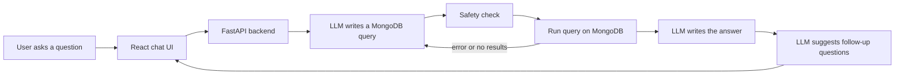
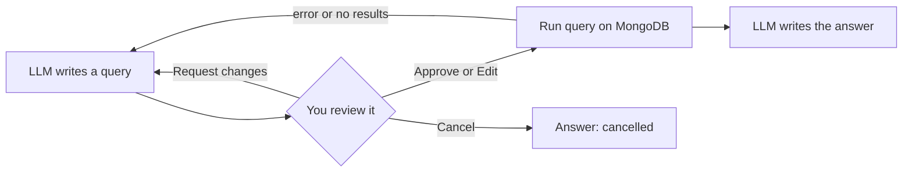

# Procurement AI Assistant

Ask questions about California state purchasing in plain English, and get answers with charts and tables.

## Project explanation

The State of California publishes its large purchases from fiscal years 2012–2015
([Kaggle dataset](https://www.kaggle.com/datasets/sohier/large-purchases-by-the-state-of-ca)).
It has 346,018 line items from 204,002 purchase orders, worth about $151 billion in total.

Finding answers in this data normally needs someone who can write database queries. This project
removes that step. You type a question like:

- "How many orders were created in each quarter of 2014?"
- "Which quarter had the highest spending?"
- "What are the 5 most frequently ordered line items?"

The assistant turns the question into a MongoDB query, runs it on the real data, and explains
the result in simple words.

What the app can do:

- **Answer in plain English** with the exact numbers from the database.
- **Show a chart and a table** for each answer, and let you download the table as CSV.
- **Show the query** it used, so you can check how the answer was calculated.
- **Remember the conversation**, so you can ask follow-ups like "and in 2013?".
- **Suggest follow-up questions** after each answer.
- **Keep chat history**, so you can go back to old conversations at any time.
- **Fix its own mistakes**: if a query fails or returns nothing, it reads the error and tries
  again (up to 3 times).
- **Stay safe**: it can only read data. It can't change or delete anything.
- **Validation mode** (optional): you approve each query before it runs. See below.

The project also has an evaluation with 29 test questions. Each question is checked against an
answer computed directly in MongoDB. In one full run with fixed prompts, the assistant answered
**28/29 correctly (97%)**, with a median answer time of **4.1 seconds**. The one miss was the
weather question: it declined correctly and invented nothing, but did not say clearly that it has
no live data. See [`backend/eval/report.md`](backend/eval/report.md) for the details.

## Stack

**Backend (Python)**

- **FastAPI**: the web API, with streaming answers (Server-Sent Events)
- **LangGraph + LangChain**: the AI agent steps (write query → run → retry → answer)
- **LLM**: any OpenAI-compatible API. I used Groq with `openai/gpt-oss-120b`.
- **PyMongo**: connects to MongoDB
- **Pandas**: cleans the CSV before loading it

**Database**

- **MongoDB**: stores the purchase orders and the chat history

**Frontend**

- **React + TypeScript**, built with **Vite**
- **Recharts**: charts
- **react-markdown**: formats the answers (tables, bold text)

The frontend and backend are separate projects in the `frontend/` and `backend/` folders.

## Project flow



**1. Loading the data (one time)**

The script `backend/scripts/load_data.py` reads the CSV and cleans it:

- turns money text like `$1,234.00` into numbers, and date text into real dates
- adds helper fields: year, quarter, month, fiscal year quarter, and a cleaned item name
  (so "Toner" and "toner " count as the same item)
- adds an `order_id` (department + purchase order number), because different departments reuse
  the same order numbers. Without it, orders from different departments would be counted as one.
- loads everything into MongoDB and creates indexes so queries are fast

**2. The user asks a question**

The React app sends the question to the backend. The backend also loads the earlier messages of
this conversation from MongoDB, so the AI understands follow-ups.

**3. The AI writes a query**

The LLM gets the question plus a description of the data: all the fields, the real values of
categories (departments, acquisition types…) and business rules. For example, "orders" means
distinct order IDs, and "spending" means the sum of total price. It returns a
MongoDB aggregation pipeline.

**4. Safety check and run**

Before running, the backend checks the query:

- only read-only steps are allowed (nothing that writes or deletes)
- results are limited to 500 rows
- there is a 20 second time limit

Then the query runs on MongoDB.

**5. Self-correction**

If the query fails or returns nothing, the error goes back to the LLM, which fixes the query and
tries again (up to 3 attempts).

**6. The answer**

The LLM writes a short answer using only the numbers from the results. Then it suggests 3
follow-up questions.

**7. Back to the user**

The backend streams everything to the app live: the progress steps, the data, then the answer
word by word. The app shows the answer with a chart, a table and the query. The conversation is
saved in MongoDB so it shows up in the chat history.

## Validation mode

Validation mode lets a person check the query before it touches the database. Turn it on with
the **Validation mode** switch at the top right. It is off by default, and the app remembers
your choice.

When it is on, the assistant stops after writing the query and shows you:

- the plan, in plain English
- the exact MongoDB query it wants to run

Nothing runs until you choose one of these:

- **Approve & run**: run the query as it is.
- **Edit query**: change the query yourself, then run it. Your edited query goes through the
  same safety check, so it still can't write or delete anything.
- **Request changes**: tell the AI what to change (for example "use fiscal quarters instead").
  It writes a new query and asks you again.
- **Cancel**: stop. Nothing is run.

If an approved query fails or returns nothing, the AI fixes it, and the fixed query also needs
your approval.



How it works: the LangGraph agent has a `review_query` step that pauses the run with
`interrupt()`. The paused run is saved in MongoDB (LangGraph's `MongoDBSaver`), so the waiting
query is still there if you refresh the page or restart the backend. Your choice is sent to
`POST /api/chat/resume`, and the agent continues from where it stopped. Paused runs are kept for
7 days.

## Setup

### What you need

- **Python** 3.11 or newer
- **Node.js** 20 or newer
- **MongoDB** 7 or newer, running on your machine
- **An API key** from an OpenAI-compatible LLM provider (for example [Groq](https://console.groq.com/keys)
  or [OpenAI](https://platform.openai.com/api-keys))

### 1. Get the code

```bash
git clone <this-repo-url>
cd procurement-ai-assistant
```

### 2. Install and start MongoDB

On macOS with Homebrew:

```bash
brew tap mongodb/brew
brew install mongodb-community
brew services start mongodb-community
```

If Homebrew asks you to trust the tap, run `brew trust mongodb/brew` and install again.
For other systems, follow the [MongoDB install guide](https://www.mongodb.com/docs/manual/installation/).

### 3. Download the dataset

Download the CSV from [Kaggle](https://www.kaggle.com/datasets/sohier/large-purchases-by-the-state-of-ca)
and save it as:

```
data/raw/purchase_orders_2012_2015.csv
```

### 4. Set up the backend

```bash
cd backend
python3 -m venv .venv
.venv/bin/pip install -r requirements.txt
cp .env.example .env
```

Open `backend/.env` and add your API key. For Groq:

```
LLM_API_KEY=your-key-here
LLM_BASE_URL=https://api.groq.com/openai/v1
LLM_MODEL=openai/gpt-oss-120b
```

For OpenAI, leave `LLM_BASE_URL` empty and set `LLM_MODEL=gpt-4.1`.

The `.env` file is ignored by git, so your key stays private.

### 5. Load the data into MongoDB

```bash
.venv/bin/python -m scripts.load_data
```

This takes about 30 seconds. If your CSV is somewhere else, add its path at the end of the command.

### 6. Start the backend

```bash
.venv/bin/uvicorn app.main:app --reload --port 8000
```

You can check it is working at http://localhost:8000/api/health.

### 7. Start the frontend

In a new terminal:

```bash
cd frontend
npm install
npm run dev
```

Open http://localhost:5173 and start asking questions.

### 8. Run the evaluation (optional)

From the `backend` folder:

```bash
.venv/bin/python -m eval.run_eval
```

This runs the 29 test questions and writes the results to `backend/eval/report.md`.
On Groq's free plan, add `--pause 45` to stay under the tokens-per-minute limit.
